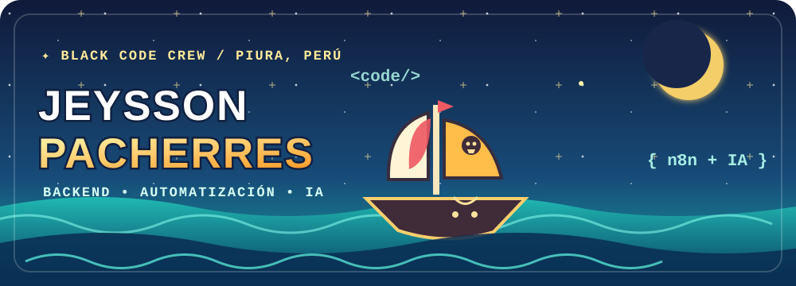

 

---

## Sobre mí

Estudiante de **Ingeniería de Sistemas e Informática** en la UTP. Desarrollo soluciones orientadas a procesos reales mediante backend, automatización, APIs e inteligencia artificial.

### Tecnologías y herramientas

 

---

## Proyectos destacados

<table align="center">
<tr>
<td width="50%"></td>
<td width="50%"></td>
</tr>
<tr>
<td width="50%"></td>
<td width="50%"></td>
</tr>
</table>

### 01 · Sistema de asistencia biométrica

Gestión de asistencia conectada a un reloj **ZKTeco** por IP. Backend en PHP y MySQL con reportes y control de accesos.

`PHP` `MySQL` `ZKTeco`

### 02 · Bot para Marketplace

Flujo de Telegram que automatiza publicaciones en Facebook Marketplace. **n8n** orquesta el proceso y **Google Gemini** analiza imágenes de productos.

`n8n` `Google Gemini` `Telegram API`

### 03 · Asistente académico

Bot de Telegram con contexto de conversación e historial, ejecutado con **Groq (Llama 3 70B)** mediante un flujo de n8n.

`n8n` `Groq` `Telegram API`

### 04 · Propuesta web UTP

Propuesta de experiencia web para Ingeniería de Sistemas, desarrollada mediante sketch, storyboard y wireframes en Figma.

`UX/UI` `Wireframing` `Figma`

---

## Actividad en GitHub

La animación de contribuciones depende de la ejecución del workflow del repositorio. Si no se muestra, puedes consultar directamente [mis contribuciones en GitHub](https://github.com/JeyssonPacherresMontero).

<picture>
  <source media="(prefers-color-scheme: dark)" srcset="https://raw.githubusercontent.com/JeyssonPacherresMontero/JeyssonPacherresMontero/output/snake-dark.svg" />
  
</picture>

  

---

**Gracias por visitar mi perfil.**

