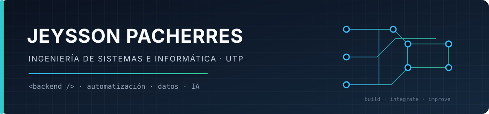

## Perfil

Estudiante de **Ingeniería de Sistemas e Informática en la Universidad Tecnológica del Perú (UTP)**, interesado en el desarrollo de software, la automatización de procesos y la construcción de soluciones basadas en datos e inteligencia artificial.

Me enfoco en aprender mediante proyectos y en crear herramientas que resuelvan necesidades concretas. Actualmente busco oportunidades de prácticas preprofesionales y colaboración en equipos de tecnología.

## Áreas y tecnologías

- **Backend:** PHP, Python, Node.js, NestJS
- **Frontend:** JavaScript, React, Next.js
- **Datos:** MySQL, PostgreSQL
- **Automatización e integración:** n8n, APIs REST, Telegram API
- **Herramientas:** Git, GitHub, Docker, Figma
- **IA aplicada:** integración de modelos y APIs de inteligencia artificial

## Proyectos seleccionados

### Sistema de control de personal y asistencia
Sistema web para gestionar personal y asistencia, con integración a reloj biométrico ZKTeco mediante red IP.

**Tecnologías:** PHP · MySQL · ZKTeco

### SAASTUCANCHA
Plataforma web para la gestión y reserva de canchas deportivas, con frontend y backend separados y pasarela de pagos en integración.

**Tecnologías:** Next.js · NestJS · PostgreSQL

### Automatización de publicaciones para Marketplace
Flujo que coordina Telegram, n8n y servicios de IA para apoyar la preparación de publicaciones de productos.

**Tecnologías:** n8n · Telegram API · Google Gemini

### Asistente académico
Asistente conversacional en Telegram con gestión de contexto e integración con un modelo de lenguaje.

**Tecnologías:** n8n · Telegram API · Groq

### Data Warehouse académico
Proyecto académico de análisis de comportamiento financiero y morosidad estudiantil mediante un modelo dimensional.

## Actividad y contribuciones

<picture>
  <source media="(prefers-color-scheme: dark)" srcset="https://raw.githubusercontent.com/JeyssonPacherresMontero/JeyssonPacherresMontero/output/snake-dark.svg" />
  
</picture>

 

## Formación

**Ingeniería de Sistemas e Informática**  
Universidad Tecnológica del Perú (UTP)

## Enlaces

---

Piura, Perú · Abierto a prácticas preprofesionales, oportunidades trainee y colaboración en proyectos tecnológicos.

